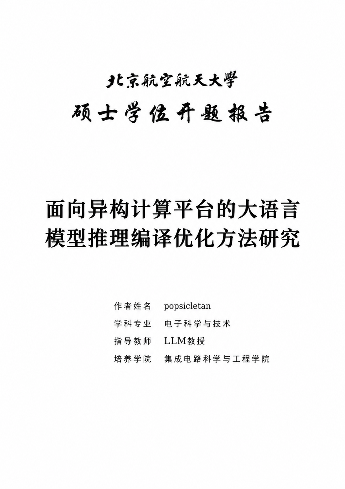

# 北航硕士开题报告 LaTeX 模板

本整理版作者：[**popsicletan**](https://github.com/PoPsicleTan)。原模板作者、来源和许可见 [NOTICE.md](NOTICE.md)。

[](https://github.com/PoPsicleTan/buaa-master-proposal/actions/workflows/latex.yml)

面向北京航空航天大学硕士开题报告的中文模板，支持学术学位与专业学位。
结构为 **中文封面 → 目录 → 五章正文 → 参考文献**。
下载后只需填写个人信息、替换正文和文献，即可编译。

这是学生维护的非官方模板。章节组织和版式是可修改的起点，提交时以所在学院当年的开题要求为准。
默认使用 TeX Live 自带的 Fandol 中文字体；仓库不附带商业字体、个人开题正文或论文附件。

以下为作者原报告封面的公开展示图，姓名、导师与题目已替换为示例信息。



[查看完整示例 PDF](docs/example.pdf) · [写作与排版说明](docs/WRITING.md) · [来源说明](docs/ORIGIN.md)

原模板的 7 个示例章节及配套图片、文献也已保留，见 [原始示例说明](examples/README.md)。
在项目根目录运行 `latexmk -xelatex examples-original.tex` 可生成原章节的演示版本，
或直接 [查看原章节示例 PDF](docs/original-examples.pdf)。

## 快速开始

1. 下载仓库 ZIP，解压；也可使用 Git 克隆。
2. 在 `config/info.tex` 填写题目、姓名、学号、学院、专业、导师和日期。
3. 修改 `chapters/` 下的正文，将 `bibliography/references.bib` 换成自己的文献。
4. 使用 **XeLaTeX + BibTeX** 编译。推荐在项目根目录执行：

```sh
latexmk -xelatex main.tex
```

输出为根目录 `main.pdf`。清理辅助文件、保留 PDF：

```sh
latexmk -c
```

没有 latexmk 时依次执行：

```sh
xelatex main.tex
bibtex main
xelatex main.tex
xelatex main.tex
```

### Overleaf

上传整个项目 ZIP，将主文件设为 `main.tex`，编译器选择 **XeLaTeX**。
首次使用保持 `fontset=fandol`。本文献配置使用 BibTeX，无需改为 Biber。
在线编译时间受项目大小和账户环境影响，本模板不依赖外部图片下载或 shell escape。

### 本地环境

使用包含中文支持的 TeX Live 或 MacTeX。所需主要组件为 `ctex`、`xeCJK`、`fontspec`、
`fandol`、`tex-gyre`、`lm`、`gbt7714`、`latexmk` 及常见 LaTeX 宏包。
如果提示 `gbt7714.sty not found`，在自行安装的 TeX Live 中运行 `tlmgr install gbt7714`；
系统包管理器安装的 TeX Live 应通过对应包管理器补齐组件。

Ubuntu/Debian 的精简安装还需显式安装 `fonts-texgyre` 包，它提供默认西文所需的 OpenType 字体；
仅安装 `texlive-fonts-recommended` 并关闭推荐依赖时，可能不会安装该字体包。

Windows 的 TeX Live 还需要可供 latexmk 调用的 Perl；可直接使用上述四条手动编译命令排查。
建议先在项目根目录成功编译，再配置编辑器。

## 硕士开题选项

选项位于 `main.tex` 的 `\documentclass[...]` 中。

| 选项 | 默认值 | 可选值与作用 |
| --- | --- | --- |
| `degree` | `academic` | `academic`：学术学位硕士；`professional`：专业学位硕士。改变封面的学位类型和专业标签 |
| `layout` | `print` | `print`：封面后留白，目录为奇数页时补一张空白页；目录为偶数页时不补；`electronic`：不插入 |
| `subject` | `STEM` | `STEM`：理工类，第1章、1.1、1.1.1；`HSS`：人文社科类，一、（一）、1、 |
| `fontset` | `fandol` | `fandol`：TeX Live 自带字体；`windows`/`mac`：CTeX 对应系统字体配置；`none`：自行配置 |
| `colorlinks` | `false` | `true`：彩色链接；`false`：黑色无框链接。两种都能点击 |
| `longtitle` | `false` | `true`：封面题目改用较小字号，适合较长题目；仍应检查换行 |

打印模式下，目录为 1 页时补一页空白，为 2 页时直接接正文；更多页按相同的奇偶规则处理。
封面后保留一页空白，使目录从右页开始；正文各章不强制从奇数页开始。
目录使用大写罗马页码；正文从阿拉伯数字 1 开始；封面和空白页不显示页码。
正文和参考文献使用统一页眉“北京航空航天大学硕士开题报告”。

专硕电子版示例：

```latex
\documentclass[degree=professional,layout=electronic,subject=STEM,fontset=fandol]{buaa-proposal}
```

选用 `windows` 或 `mac` 前，需确保运行编译器的机器确实具有对应字体；本地有字体不代表 Overleaf 也有。
Fandol 用于便捷编译，字形与 Windows 宋体、黑体不完全相同；如学院明确指定字体，请更换后复核版式。
西文字体默认采用 TeX Gyre Termes，可在 `config/packages.tex` 中用 `\setmainfont{...}` 覆盖。
`fontset=none` 的中文配置示例也在该文件中。

## 个人信息

`config/info.tex` 使用 `\ProposalSetup{...}`，无需填写英文题目或英文姓名。

| 字段 | 必填 | 说明 |
| --- | --- | --- |
| `title` | 是 | 中文题目，自动换行 |
| `author` / `student-id` | 是 | 姓名 / 学号 |
| `department` / `major` | 是 | 学院 / 学科或专业名称 |
| `supervisor` | 是 | 导师姓名与职称 |
| `date` | 是 | 报告日期，作为原样文本显示 |
| `confidentiality` | 否 | 默认“公开”，仅控制封面文字 |
| `co-supervisor` | 否 | 联合导师，留空不显示 |
| `special-program` | 否 | 专项计划，留空不显示 |

## 目录结构

```text
.
├── main.tex                    # 主入口与模板选项
├── examples-original.tex       # 原模板示例演示入口
├── buaa-proposal.cls            # 硕士开题专用类
├── config/
│   ├── info.tex                # 个人信息
│   └── packages.tex            # 额外宏包、自定义字体和命令
├── chapters/
│   ├── 01-background.tex       # 选题依据
│   ├── 02-literature.tex       # 国内外研究现状
│   ├── 03-objectives.tex       # 研究目标与研究内容
│   ├── 04-methods.tex          # 研究方案与可行性分析
│   └── 05-schedule.tex         # 研究计划与预期成果
├── bibliography/references.bib # 示例文献
├── figures/                    # 自己的插图
├── examples/                   # 原始示例章节、书目、来源摘要和兼容定义
├── docs/                       # 写作说明、来源和示例预览
├── .github/workflows/latex.yml # 自动编译与选项检查
├── .latexmkrc                  # 编译配置
└── LICENSE                     # MIT 许可证
```

章节可增删、合并或重命名，并同步修改 `main.tex` 中的 `\input`。
开题主入口不生成英文封面、声明、中英文摘要或毕业论文附加页。
原模板的总结、附录、成果、致谢与作者简介示例保存在 `examples/`，由示例入口演示。
正文示例是填写提示，示例文献只是排版演示，请在提交前逐项替换。

## 常见问题

- **文献或交叉引用显示问号**：先确认 `\cite` / `\ref` 的键名，再完整运行 latexmk，或按四步顺序编译。
- **中文字体找不到**：先恢复 `fontset=fandol`；检查是否完整安装中文字体包。
- **题目太长**：启用 `longtitle=true`，检查封面是否仍在一页内；联合导师和专项计划也会增加封面高度。
- **图片或表格移到下一页**：这是浮动体行为，优先调整尺寸、文字和 `[htbp]`，不要用负间距强拉回。
- **想去掉空白页**：用 `layout=electronic`。
- **旧工程怎么迁移**：把个人信息改填到 `config/info.tex`，按需复制正文、图片和文献；不要直接覆盖专用类文件。

## 获取模板与协作

[下载完整模板 ZIP](https://github.com/PoPsicleTan/buaa-master-proposal/archive/refs/heads/main.zip)，
或通过 [Use this template](https://github.com/PoPsicleTan/buaa-master-proposal/generate) 创建自己的项目。
也可直接克隆：

```sh
git clone https://github.com/PoPsicleTan/buaa-master-proposal.git
cd buaa-master-proposal
```

仓库中的默认个人信息、示例 PDF、图片和文献为公开示例。对外分享自己修改后的版本时，请检查个人信息。
`.gitignore` 排除编译缓存和字体文件，但不会识别写入 `.tex` 的个人信息。

GitHub Actions 会编译默认模板及原章节示例，并检查专硕、人文社科、自定义字体和目录分页；PDF 从该次运行的 Artifacts 下载。
该工作流仅构建文件，不自动提交 PDF、不创建 Release。修订格式时请附上最小复现、编译器版本与 PDF 截图。

维护者可运行 `python scripts/check-options.py` 检查配置。该脚本需要 Python 3 和 latexmk；
安装 Poppler 后会进一步核对空白页、封面字段与参考文献。测试使用自带示例，临时目录中的修改不会覆盖正文。
当前验证环境与未测试项目见 [VALIDATION.md](docs/VALIDATION.md)。

## 许可与致谢

本仓库的新类文件、填写示例和说明采用 [MIT License](LICENSE)。
整理时参考了既有开题稿的章节结构和布局，并向 [CheckBoxStudio/BUAAThesis](https://github.com/CheckBoxStudio/BUAAThesis) 致谢。
原作者及贡献者署名、上游固定版本和原许可证保留在 [NOTICE.md](NOTICE.md)、
[ORIGIN.md](docs/ORIGIN.md) 与 [licenses/](licenses/) 中。
